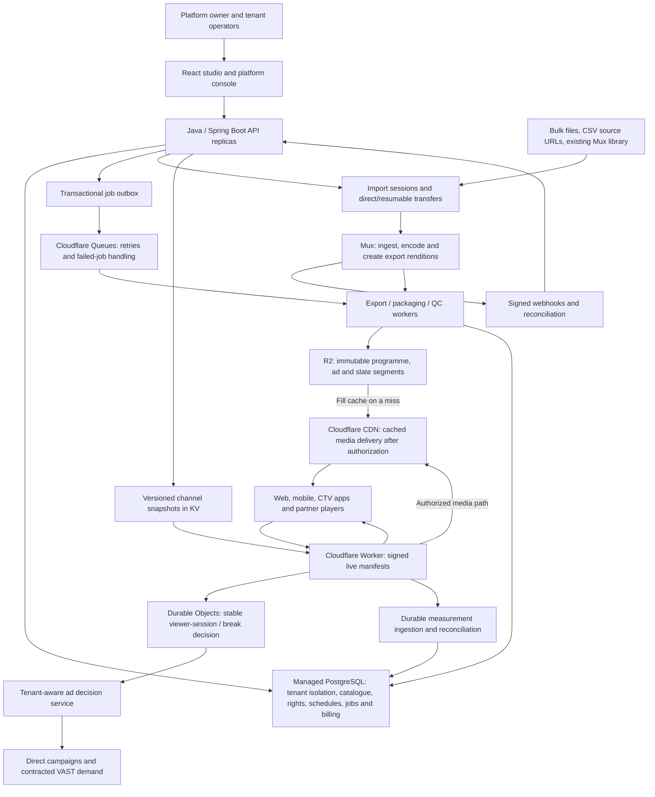

# FAST Studio: production architecture, features and budget
Prepared 31 October 2026 (Asia/Calcutta).

## Decision and present position

The intended product is a multi-tenant FAST channel operations and monetization platform: upload a licensed catalogue in bulk, prepare media, schedule linear channels, deliver personalized advertising, distribute approved feeds, and report usage and commercial performance.

The target is **Mux for encoding/renditions; R2 as the media origin; Cloudflare CDN for cached segment delivery; Cloudflare Worker for final live manifests and playback authorization**. The queue coordinates background work. PostgreSQL is authoritative for tenant, catalogue, scheduling, job and commercial state.

This is a planning estimate based on inspected local code and public vendor documentation, not a production sign-off or vendor quotation. No infrastructure was purchased or deployed. The last completed local verification was on 30 October: 83 backend tests, 9 Worker tests, frontend build, package and Worker dry-run passed. Those checks did not validate real Mux/R2 media transitions, external demand or partner acceptance.

The current Mux connector retrieves a master and runs our FFmpeg ladder. The current Library uploads one file through Java. Therefore the desired Mux-encoded/R2-served path, bulk resumable ingestion and durable job orchestration still need implementation. Shared per-break decisions and HTTP beacon retries have been added; long-outage reporting durability remains open.

## Architecture



Viewer applications and approved distribution platforms consume the stream; the studio's Watch page is a test/preview surface, not a complete suite of consumer mobile/CTV applications.

### Ingestion and media preparation

1. Create one import session with item-level metadata, duplicate keys, quotas and validation errors.
2. Upload large local files directly to Mux with resumable transfers, provide authenticated reachable source URLs, or sync an existing connected Mux catalogue. CSV links the media to title, type, series, season, episode, language and rights.
3. Record processing via signed, replay-safe webhooks; reconcile missed events periodically. Queue messages carry identifiers and stable object references, not video bytes or expiring download links.
4. Request the explicit encoded outputs needed for the delivery ladder. Export them to packaging workers and R2, avoiding another full programme encode where compatible.
5. Validate video/audio, keyframes, segment durations, cross-rendition alignment, loudness, captions, rights and object completeness before marking an asset schedulable.
6. Publish immutable media revisions and clean old/failed revisions under a defined retention policy.

**Critical feasibility gate:** Mux supports specific-resolution advanced static MP4 exports, but that does not establish aligned five-second GOPs, destination loudness, or seamless joins in our current playout. Prove representative long-form programme -> ad -> programme transitions and rendition switching. Remuxing cannot invent a missing keyframe. If outputs do not satisfy the channel profile, decide a provider-supported packaging approach or an explicit conditioning encode and re-cost it. This design must not be represented as fully implemented today.

### Control plane and scheduling

Keep the Java modular monolith, with independent application replicas and background workers, rather than splitting every module into a service. Managed PostgreSQL, tenant RLS/permissions, secrets management, OIDC/session controls and audit logs support tenant separation.

Tenant rules choose the next episode in numeric season/episode order, apply rights and timezones, retain manual placements, and produce drafts. Publication creates versioned, validated channel snapshots. No encoder runs per viewer or per repeated showing of the same asset.

KV is a distribution cache, not the authoritative catalogue or an immediate revocation mechanism. Define the maximum schedule/rights propagation delay, snapshot runway, emergency stop and stale-snapshot behavior. A backend outage can continue only as far as valid available published content and policy allow.

### Playback, advertising and measurement

The Worker produces private live manifests from published snapshots and time. Their segment URLs must resolve to R2-backed media to obtain R2's zero-egress benefit. A manifest on Cloudflare that points to Mux segments still causes Mux delivery usage.

Authorize playback and segment access, implement actual geo/rights enforcement, and cache immutable media independently of viewer-specific manifests. The existing simulation country selector is not production geo enforcement.

### CDN and origin delivery

Cloudflare CDN is an explicit part of the target. R2 is durable origin storage; the CDN serves cached programme/ad/slate segments near viewers, fetching from R2 on a cache miss. The Worker generates the viewer-specific live manifest and enforces the chosen authorization path. Personalized manifests remain private/no-store; immutable segments can share cache entries after access checks.

Use a production custom domain and explicit cache policy, with an authorization design that does not expose a bypass origin. An R2 binding GET in a Worker does not itself establish a shared CDN cache, and Cache-Control headers alone are not evidence that the target caching path is deployed. Current code has an optional MEDIA_BASE custom-domain path and a direct Worker-to-R2 fallback; production CDN configuration and cache-hit evidence remain outstanding. [R2 custom domains and caching](https://developers.cloudflare.com/r2/buckets/public-buckets/)

The cost model charges all modeled Worker invocations and R2 segment reads, conservatively crediting no CDN cache savings. Cache hits should reduce origin reads when configured, but authorization Worker charges depend on routing. R2's zero-egress policy covers its delivery; storage, request, Worker and any selected paid CDN/security/support features remain billable. No Enterprise CDN/security quote or optional cache-product fee is included. Tune and re-cost the actual deployed route before treating the budget as a quote.

Finalize one decision per tenant/session/break, including slate, in shared state. Apply verified viewer consent/audience claims, contextual fallback, caps, pod fitting, competitive separation and campaign policy. Keep direct low-latency decisions separate from background bulk-import jobs.

Collect replay-safe delivery events durably, batch writes, roll up analytics, and reconcile with authoritative ad-provider statements. Selected ads are not billable impressions. Ad demand, CPM, fill, revenue and partner placement are commercial dependencies rather than guarantees from implementing VAST.

## Product capability inventory

Status meanings: **Implemented** means a local prototype path exists; **Partial** means material feature/integration/validation work remains; **Planned** means it should not be sold as available.

| Product area / PRD references | What customers get | Present state |
| --- | --- | --- |
| Companies and staff access — F01 | Platform owner, tenants, roles, invitations, account recovery, isolation and audit | Implemented local accounts/RLS; production identity integration and operational acceptance remain |
| Media catalogue — F02 | Movies, episodes, shorts, ads and platform-defined types; tenant entitlements; metadata/search | Implemented first version; types map to supported base processing behaviors |
| Bulk onboarding and QC — F14/F15 | Resumable multi-file upload, CSV mapping, duplicates, progress, item errors and retry | Planned workflow; existing upload is single-file; Mux bulk catalogue sync exists |
| Rights — F03 | Time windows, territories, destination rules, advertising permission and alerts | Implemented core rules; actual production geo and policy validation remain |
| Channel setup — F04 | Channel identity, lifecycle, eligible fallback and readiness | Implemented prototype |
| Programming — F05/F39 | Manual schedules, autofill, cue points, gaps, daily next episode, season rollover and encore | Implemented first version; saved-rule editing, multiple encores and full recurrence grammar remain |
| Publication and guide — F06 | Immutable versions, stale-edit checks, restoration workflow, XMLTV/JSON and episode metadata | Implemented core; partner-grade validation remains |
| Preview and virtual-linear playback — F07/F40 | Shared linear programme timeline with standby and rights fallback | Implemented prototype over our encoded media; Mux export playback unverified |
| Campaign operations — F08/F19 | Creatives, flights, direct sales, reservations and campaign control | Partial; approval, orders/line items and production pacing remain |
| Personalized ads — F20/F43 | Signed audiences, contextual fallback, selection caps, SSAI and SGAI | Implemented foundation; actual viewer-app consent/identity and measurement integration remain |
| Ad markers — F41 | SCTE-35 ownership markers and inspection | Implemented prototype; destination acceptance required |
| External demand — F18/F27 | VAST waterfalls and multiple contracted demand partners | Connector foundation; real integration, trafficking and yield validation remain |
| Distribution — F09/F17/F42/F45 | Destination profiles, readiness, stream/guide/MRSS packs, partner handoff | Partial; handoff is simulated and real destination approval is outstanding |
| Operations — F10/F25 | Monitoring, alerts, acknowledgment, probes, support and recovery | Basic alerts exist; live probes, SLOs, drills and sustained-load evidence remain |
| SaaS billing — F11/F12/F13 | Plans, quotas, metered usage, payments/invoices, overages and dunning | Planned production commercial workflow |
| Controlled approvals — F16 | Separate reviewer approval for sensitive rights/publish actions | Planned |
| Measurement and privacy — F21/F24 | Provider reports, consent controls, deduplication, exclusions and discrepancies | Partial; authoritative settlement and full privacy/retention integration remain |
| Finance — F22/F23 | Revenue shares, royalties, statements and channel contribution margin | Planned; dashboards must not imply reconciled money today |
| Sponsorship and commerce — F26/F37 | Sponsored dayparts, QR campaigns and approved shopping overlays | Planned |
| Regional and catch-up — F28/F34 | Regional rights/ads, multilingual guides, catch-up/AVOD windows | Planned beyond current territory rules |
| Enterprise protection — F29/F38/F54 | SSO/SCIM, support access, multi-region failover, DRM where required | Signed links foundation; full enterprise/DRM/resilience scope planned |
| Integrations and partners — F30/F31 | Partner APIs, channel sharing, resellers and white-label operation | Prototype partner APIs/sharing; complete reseller/webhook commercial workflows remain |
| Managed operations — F32 | Paid launch, scheduling and ad-ops services with tracked scope | Planned; staffing is a separate operating cost |
| Live and output formats — F33/F51/F52 | Live source switching, SRT/HLS restream, overrun handling, DASH/SRT/HEVC outputs | Planned |
| AI and licensing — F35/F36 | Human-reviewed metadata/schedule suggestions and content licensing marketplace | Planned; daily episode ordering itself needs no AI |
| Branding — F48 | Logo, bumpers, up-next graphics and safe-area validation | Planned complete workflow |
| Guide enrichment — F49 | Licensed metadata matching, artwork and guide quality reports | Planned |
| Readiness — F46/F47/F50 | Destination checks, measured loudness and catalogue sufficiency | Partial local checks/encoding; full evidence-based reports planned |
| Localization — F53 | Studio and email language choices | Planned |
| Onboarding — F44 | First-channel checklist and plain-language learning | Implemented prototype |

Consumer Android/iOS/CTV applications, licensed content acquisition, distribution contracts and an in-house advertising sales operation are not provided by the current studio. No budget below includes building a full consumer app suite.

## Deployment shape

- Pilot: one region, two small API replicas, managed PostgreSQL with standby/backups, one separately deployed packaging worker, staging, secrets, CI/CD and external monitoring.
- Launch: larger redundant API/database capacity, independently scaled worker pool, durable event collection, rolled-up reports and capacity tested at expected peaks.
- Scale: partition/retain events, batch ingestion, autoscale measured bottlenecks, tune edge caching and decision lifetimes, and obtain operational/provider acceptance for actual peak load. Add an analytics store or regional recovery only after its requirement is costed.
- Avoid Kubernetes, Kafka, Elasticsearch and Redis as default prerequisites. None is required merely because the catalogue contains large movies.
- Team ownership, on-call coverage, tested recovery and a paid-services support agreement are separate from the cloud-resource bill.

## One-customer starting budget

For a smaller first customer, use a separate lean estimate rather than the three-tenant benchmark below. Assumptions: 1-3 channels, 100 catalogue hours (roughly 50 two-hour movies), 10 new hours/month, 10-50 average concurrent viewers total, 1080p maximum retained source, and exported 360p/720p/1080p outputs. This is a single API instance and managed PostgreSQL without a hot standby; it does not provide the redundant topology used in the larger scenarios.

| Monthly infrastructure component | USD allowance |
| --- | ---: |
| API VM | $24-$48 |
| Managed PostgreSQL | $30-$60 |
| Small background export/packaging worker capacity | $10-$30 |
| Cloudflare Workers, shared decision state, queue and KV | $10-$50 |
| R2 encoded storage and reads | $6-$12 |
| Backups, monitoring and transactional mail | $10-$25 |
| Rounded infrastructure budget | $100-$250 / INR 9,500-23,750 |

Mux, modeled separately: 100 hours of warm 1080p asset storage is $18/month; three retained static outputs are $11.70/month. Preparing and downloading 10 new hours is approximately $17.16 before free credits/volume savings. Allow **$45-$60/month (INR 4,275-5,700)** for Mux under this profile.

Combined lean recurring budget: **$145-$310/month, approximately INR 14,000-30,000**. A practical initial allowance is INR 20,000-30,000/month. Preparing/downloading the starting 100 hours is about $172 before credits, or approximately INR 16,300 one-time, in addition to ordinary retention/runtime. Allow INR 15,000-20,000 for this initial Mux export. These are planning figures, not charges already incurred.

If the catalogue is 1,000 hours instead, with the same 10 new hours/month and low viewership, modeled Mux retention plus preparation/downloads becomes about $313/month and R2 output storage about $61/month. Total lean operation is then roughly INR 45,000-65,000/month before taxes and extra provider requirements. One customer does not mean a fixed cost regardless of catalogue or viewing volume.

This estimate assumes the target Mux-export/R2-delivery integration succeeds; it is not a claim that the current master-download/re-encode implementation has the same costs. It excludes engineering, consumer apps, original-file archives, DRM, paid ad-provider/platform contracts, dedicated support and taxes. Large 4K sources, extra renditions, greater average concurrency or redundant application/database capacity need re-costing.

## Cost model assumptions

All three scenarios were requested. Totals are platform-wide, not per tenant or channel. Average concurrent viewers mean the average across the entire 30-day month; peaks need separate capacity testing.

| Scenario | Tenants | Channels | Catalogue hours | New hours/month | Average concurrent viewers total | Viewer-hours/month |
| --- | ---: | ---: | ---: | ---: | ---: | ---: |
| Pilot | 3 | 10 | 1,000 | 100 | 100 | 72,000 |
| Launch | 10 | 30 | 5,000 | 500 | 1,000 | 7,20,000 |
| Scale | 50 | 150 | 20,000 | 2,000 | 10,000 | 72,00,000 |

Common assumptions:

- 30 days / 720 hours. Three encoded outputs: 360p, 720p, 1080p; stored ladder averages 9 Mbps aggregate (4.05 GB/catalogue-hour), including an approximate allowance for audio/container overhead.
- Source and retained Mux asset resolution capped at 1080p for the benchmark. Larger/4K masters, additional audio, captions, more renditions and retained originals add cost.
- Average viewer receives 3 Mbps (1.35 GB/watch-hour). Actual delivery is approximately 97.2 TB, 972 TB and 9.72 PB per month across the scenarios.
- Five-second segments and a media playlist request every 2.5 seconds; one active rendition and muxed audio assumed. This yields 2,160 playback requests/watch-hour. Separate audio, additional playlists, ABR switches, retries and player behavior change the counts.
- Conservative authorized Worker path for every segment plus manifest, average 2 ms CPU per request, no R2 read-cache savings. Production may use a different authorized cache path; public immutable URLs alone do not enforce playback rights.
- Basic Mux VOD input, paid explicit-resolution exports. Retain Mux asset plus all three static outputs and the R2 copy. No cold-storage discounts, Mux promotional delivery allowance or negotiated volume reductions applied to exports. Mux asset storage uses public volume tiers.
- New-media export preparation and download use conservative first-tier rates. No repeated full-catalogue exports each month.
- Operational infrastructure entries are engineering budget allowances, not measured capacity or exact provider SKUs. Paid API/ad-provider fees are excluded.
- INR conversion is a rounded planning assumption of **USD 1 = INR 95**; taxes/GST, bank FX fees and custom contract minimums are excluded.

### Monthly model in USD

| Cost component | Pilot | Launch | Scale |
| --- | ---: | ---: | ---: |
| Application replicas, managed PostgreSQL and load balancer | $250 | $700 | $2,500 |
| Packaging/export workers and transfer allowance | $100 | $300 | $1,000 |
| Monitoring, backups, transactional mail and security allowance | $100 | $250 | $800 |
| Mux asset storage, warm 1080p catalogue | $179 | $865 | $3,385 |
| Mux retained static rendition storage | $117 | $585 | $2,340 |
| R2 encoded catalogue storage | $61 | $304 | $1,215 |
| Cloudflare Worker requests and CPU | $54 | $530 | $5,289 |
| R2 segment reads, no cache savings assumed | $15 | $183 | $1,863 |
| R2 new segment writes | $0 | $0 | $15 |
| Mux new-media advanced rendition preparation | $156 | $780 | $3,120 |
| Mux downloads of newly prepared renditions | $16 | $78 | $312 |
| Durable Objects, KV and queue allowance | $40 | $350 | $3,500 |
| Subtotal | $1,088 | $4,925 | $25,339 |
| Including 25% planning contingency | $1,360 | $6,157 | $31,673 |

Budget ranges, widened for unmeasured provider and performance behavior:

| Scenario | Monthly cloud/platform services | Approximate INR/month | Initial full-catalogue export/import allowance |
| --- | ---: | ---: | ---: |
| Pilot | $1,000-$2,000 | INR 0.95-1.90 lakh | $2,000-$3,000 / INR 1.90-2.85 lakh |
| Launch | $5,000-$8,500 | INR 4.75-8.08 lakh | $10,000-$14,000 / INR 9.50-13.30 lakh |
| Scale | $25,000-$45,000 | INR 23.75-42.75 lakh | $40,000-$55,000 / INR 38.00-52.25 lakh |

The initial import allowance is additional one-time preparation/download/upload/packaging work for the starting catalogue. Ordinary first-month retention and runtime remain in the monthly column. These figures assume successful compatible exports and do not include a second full programme encode or a Plus/Premium input upgrade.

The queue is a small part of the bill. The major costs here are retaining two provider copies, generating new exported renditions, per-viewer manifest requests, durable ad state, analytics and application operations.

### Price basis and formulas

Public rates checked 31 October 2026:

- R2 Standard: $0.015/GB-month, $4.50/million Class A and $0.36/million Class B operations; internet egress is uncharged. Apply account allowances and billing rounding to an actual quote. [R2 pricing](https://developers.cloudflare.com/r2/pricing/)
- Workers Standard: $5 base, 10 million requests and 30 million CPU-ms included, then $0.30/million requests and $0.02/million CPU-ms. [Workers pricing](https://developers.cloudflare.com/workers/platform/pricing/)
- Queues: one million operations/month included on the paid plan, then $0.40/million; ordinary delivery usually uses three operations. [Queues pricing](https://developers.cloudflare.com/queues/platform/pricing/)
- Durable Objects have separate request, duration and SQLite storage/write billing. KV also has independent usage; both are allowance entries until measured. [Durable Objects pricing](https://developers.cloudflare.com/durable-objects/platform/pricing/)
- Mux explicit 360p/720p/1080p static exports are advanced renditions, with preparation, retention and download charges. Conservative combined rates used: $0.026 per source minute prepared, $0.00195 per source minute/month for the three static files, and $0.0026 per source minute downloaded once. 1080p asset retention starts at $0.003/minute-month with volume tiers. [Mux pricing](https://www.mux.com/docs/pricing/overview), [Static export capabilities](https://www.mux.com/docs/guides/enable-static-mp4-renditions)
- Infrastructure allowances are consistent with small VM and managed-database building blocks, but do not assert that a particular SKU supports the scenario. [VM reference pricing](https://www.digitalocean.com/pricing/droplets), [Managed PostgreSQL reference](https://www.digitalocean.com/pricing/managed-databases)

Formulas:

```text
watch_hours = average_concurrent_viewers * 720
R2_output_GB = catalogue_hours * aggregate_ladder_Mbps * 0.45
viewer_delivery_GB = watch_hours * average_viewer_Mbps * 0.45
segment_requests = watch_hours * 3600 / segment_seconds
manifest_requests = watch_hours * 3600 / refresh_seconds
Mux_export_preparation = new_hours * 60 * combined_export_rate
Mux_static_retention = catalogue_hours * 60 * combined_retention_rate
Mux_export_download = new_hours * 60 * combined_download_rate
```

The machine-readable scenario calculations are in [PRODUCTION_COST_MODEL.json](PRODUCTION_COST_MODEL.json). Rounded table rows can differ from rounded totals by a few dollars.

### Important sensitivities

- Deleting verified static exports after transfer removes roughly $117 / $585 / $2,340 of steady-state Mux static retention from the three models, after any temporary retention. It does not remove asset retention or prior preparation/download charges.
- Removing the Mux asset after verified migration is a different lifecycle decision: original preservation, recreation cost, deletion timing and Basic minimum storage must be designed. R2 archive storage of large masters is not included.
- Mux cold asset storage may reduce retention substantially. This estimate deliberately does not rely on that saving.
- A 4K retained source is priced differently even when delivery is capped at 1080p; re-run the model for 4K preparation, storage and outputs.
- At the Scale scenario, increasing average Worker CPU from 2 to 10 ms adds about $2,488/month before contingency. Reducing manifest refresh frequency saves requests only if playback behavior remains correct.
- Every 1 TB of additional R2 Standard retained media is about $15/month before account allowances. Transferring into R2 can still incur the source provider's download/egress and the transfer host's networking charges.
- Fully multiplexed consumer delivery, separate-audio HLS, DRM and additional destinations have different request and licensing profiles.
- R2's zero-egress fee applies to its data delivery; the total platform is neither free nor proven to be the cheapest possible architecture.

## Engineering remaining to production

These are estimates from the present implementation, not quotes. Assumed fully loaded delivery rate: INR 80,000-120,000 per person-week (40 hours), covering a blended engineering/QA/specialist team. Substitute the team's actual costs. Partner procurement/certification and content/provider access can extend elapsed time.

| Outcome | Cumulative effort from today | Indicative elapsed time with a suitable team | Engineering cost |
| --- | ---: | --- | ---: |
| Controlled production pilot: bulk ingest, proven Mux-to-R2 media, smart schedules, viewer integration, one ad path, one target, security/recovery evidence | 40-65 person-weeks | 10-14 weeks; about 4-5 delivery staff including QA/media expertise, with DevOps coverage | INR 32-78 lakh |
| First complete monetized SaaS release: pilot scope plus billing/meters, creative approvals/orders/pacing, authoritative reports, one accepted distribution pack and basic revenue-share settlement | 75-120 person-weeks total | 16-24 weeks; 4-5 engineers/specialists plus QA and fractional DevOps/product | INR 60 lakh-1.44 crore total |
| Entire F01-F54 roadmap: selected enterprise/regional/live/format/AI/licensing/commerce expansions included | 200-350 person-weeks total | 9-15 months; roughly 6 delivery staff plus commercial input | INR 1.60-4.20 crore total |

These rows are cumulative alternatives, not additive fees. Full-roadmap scope is particularly uncertain: a production marketplace, all destinations and consumer device applications can exceed it. A small team can spend less per month but takes longer; AI-generated code does not eliminate provider integration, QA or operational acceptance.

Indicative pilot work allocation:

| Work | Person-weeks |
| --- | ---: |
| Mux export feasibility, import architecture and representative media proof | 3-5 |
| Bulk sessions, resumable uploads, CSV mapping, metadata and retries | 7-11 |
| Export/packaging/QC, durable queue and publish isolation | 8-13 |
| Viewer identity/consent, ad integration and durable measurement | 8-13 |
| Production identity, migration/security fixes, CI/CD, backup, monitoring and soak/load testing | 14-23 |
| Total | 40-65 |

Paid SaaS billing, royalty/finance workflows, approved platform distribution and all roadmap features are not silently counted as already finished.

## First-year planning envelopes

Use the commercial-release engineering scope above, initial catalogue import, and 12 months of the corresponding runtime range. This deliberately budgets a full year at the stated scale; it is not a predicted growth curve. It excludes payroll after project delivery, dedicated 24/7 operations, content rights, revenue shares, legal/compliance work, ad/platform contracts, payment fees and taxes.

| Scenario | First commercial release + catalogue import + 12 months cloud |
| --- | ---: |
| Pilot footprint | Approximately INR 0.73-1.70 crore |
| Launch footprint | Approximately INR 1.27-2.54 crore |
| Scale footprint | Approximately INR 3.83-7.10 crore |

The Scale range needs additional engineering capacity evidence; its cloud spend is not a promise that the present app can sustain 10,000 average concurrent viewers.

## Recommended next gate

Spend the first 3-5 person-weeks proving Mux-generated outputs exported to R2 with representative movies/episodes/ads, rendition switching, audio/clock continuity and signed playback. Establish real preparation/storage/download charges. Then commit to the production budget and bulk ingestion workflow.

For an economical first commercial launch, start with the Pilot footprint, one media profile, one contracted ad integration and one destination. Preserve the requested daily episode and permitted viewer-targeting features, while scheduling the larger enterprise/live/finance expansions against paying requirements.

Historical findings are in [handover validation](../data/handover-validation/ASSESSMENT.md); that report predates the shared-decision and HTTP beacon retry fixes. The current scope notes are [smart programming and viewer ads](SMART_PROGRAMMING_AND_VIEWER_ADS.md) and [viewer context integration](VIEWER_CONTEXT.md).

